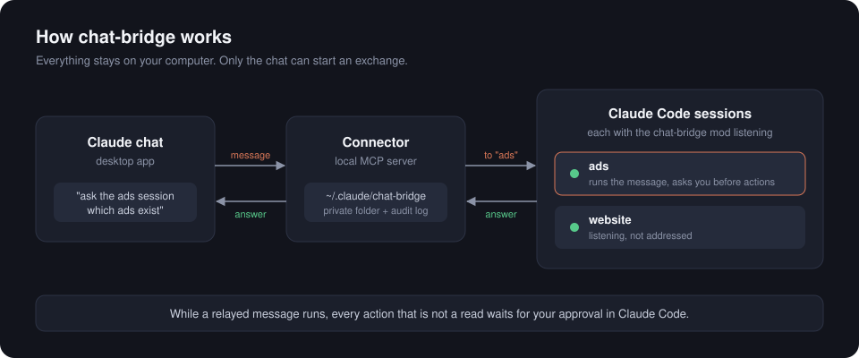
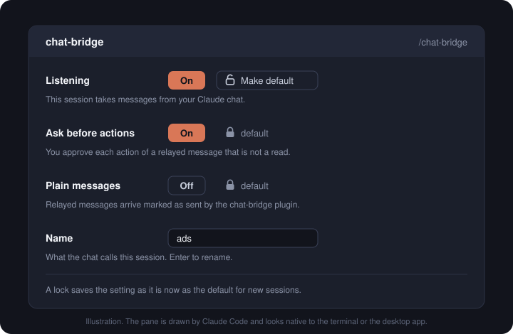

# chat-bridge

Lets a normal Claude chat (in the Claude desktop app) send messages to a Claude Code session on the same computer and read its answers.



It has two halves:

- **The connector** (`server/bridge-mcp.mjs`): a small local MCP server the desktop chat calls. Tools: `ask_claude_code`, `get_claude_code_reply`, `claude_code_status` (lists the listening sessions).
- **The mod** (`hooks/register.ts`): a Claude Code plugin that adds the `/chat-bridge` command and its settings menu. While on, the session listens under a name, runs each message the chat sends to that name as a prompt, and sends the final answer back.

Messages travel as files under `~/.claude/chat-bridge`. The bridge itself opens no network port and sends nothing off the computer.

> Experimental. It is built on Claude Code's early-access mod API, which changes between releases, and has been run on macOS only. Read [Security](#security) before turning it on.

## Install on a computer

Needs Node.js 18 or later, Claude Code, and the Claude desktop app.

```bash
git clone https://github.com/miateo/claude-chat-bridge.git
```

```bash
node claude-chat-bridge/install.mjs
```

The installer adds the connector to the desktop app's config (after writing a backup beside it) and installs the mod into Claude Code. Both run from the cloned folder, so keep it; run the installer again if you move it.

Then quit and reopen the Claude desktop app.

To install only the mod, at the prompt of a terminal Claude Code session:

```
/plugin install chat-bridge --marketplace miateo/claude-chat-bridge
```

## Use

1. Open a Claude Code session. Once the mod is installed, every session you open listens by itself, named after its folder. Rename one with `/chat-bridge on <name>`, for example `/chat-bridge on ads`.
2. In a normal chat in the desktop app, ask for example: "use chat-bridge to ask the ads session which folder it is in". With one session listening, the name can be left out.
3. `/chat-bridge off` stops that session listening.

Every interactive session listens from its start. To change that, run `/chat-bridge`, switch Listening off and press its lock: new sessions then stay off until you turn them on. A run nobody sits at (`claude -p`, an SDK host) never listens by itself.

### Settings menu

A one-line bar sits above the prompt in every session: it says whether the session is listening and under which name, and its **Settings** button opens the settings right there, and hides them again. `/chat-bridge` opens the same settings as a pane beside the conversation.



| Setting | What it does |
| --- | --- |
| Listening | Whether this session takes messages from the chat. |
| Ask before actions | On: you approve each action of a relayed message that is not a read (see Security). Off: such actions run under the session's own permissions. |
| Plain messages | On: relayed messages are submitted as if typed, without Claude Code's "plugin sent a message" wrapper. Cleaner to read; the session then gives them the weight of your own words. |
| Name | What the chat calls this session. Default: the folder's name. |

**Defaults.** Beside each switch is a lock. While the switch is at its default the lock is closed. Change the switch and the lock opens as "Make default": press it and the current value becomes the default that every new session starts from. Defaults are kept across sessions and restarts; the name is per session and has none.

### Commands

The same settings from the prompt, for a terminal habit or where a pane cannot be shown:

| Command | What it does |
| --- | --- |
| `/chat-bridge` | Opens the settings menu. |
| `/chat-bridge on [name]` | Starts listening, under `name` if given. |
| `/chat-bridge on --trust` / `--ask` | Starts listening with "Ask before actions" off / on. |
| `/chat-bridge on --plain` / `--framed` | Starts listening with "Plain messages" on / off. |
| `/chat-bridge off` | Stops listening. |
| `/chat-bridge status` | Says whether the session is listening, and how. |

An option left out keeps the setting as it stands.

## Background runs (experimental, off by default)

Normally the chat can only talk to sessions you opened. With background runs on, it can also start Claude Code by itself, unattended, in folders you allowed, and get the answer back.

> Not yet verified end to end. The approval path is tested in simulation; a real unattended run has not been observed. It lives on the `background-runs` branch until it has.

Turn it on in the settings (the bar's **Settings** button, or `/chat-bridge`), under **Background runs**:

1. Type an **approval code** of at least 4 characters and press Enter. Only you should know it.
2. Allow at least one folder: **Allow this session's folder** adds the one you are in.
3. Switch **Background runs** on.

It also needs the Claude Code command line signed in on the computer: run `claude` once in a terminal and log in.

How a run goes:

- The chat calls `start_claude_code_run` with a folder and a task. A folder that is not allowed, or not inside an allowed one, is refused.
- Claude Code runs in auto mode: its own classifier allows what looks safe and blocks what looks dangerous.
- What auto mode leaves to a person comes back to the chat. The chat shows you the exact action and asks for your approval code. You answer in the chat, in plain text, so this works wherever you are talking to the chat, a phone included, and does not depend on how an app draws a permission prompt.
- The right code allows that one action. No code or a wrong one does not, and five wrong tries refuse it. Unanswered for 15 minutes, it is refused.

What to know before turning it on:

- **The code is a shared secret with the conversation.** Once you have typed it in a chat, that conversation holds it, and a chat that has been steered by something it read could reuse it there. Start a new chat for sensitive work, and change the code if a conversation went somewhere odd.
- **Auto mode is a classifier, not a guarantee.** It judges actions against the task it was given, and the task is the relayed message.
- **A run is not sandboxed.** It runs as you. The bridge refuses a run's attempts to read or change its own files, and Claude Code is told to deny them, but that is a rule, not a wall.
- **Reads are not gated**, as with sessions: a run can read what is in its reach and the answer goes back to the chat.

## Security

A message that comes over the bridge was written by another model. If that chat has read a web page, an email or a document with instructions hidden in it, it can be steered into sending a message you never asked for, and that message then runs in a coding agent on your computer. chat-bridge is built around that risk:

- **Listening by default, asking by default.** Every interactive session listens once the mod is installed, so the approval below is what stands between a relayed message and your files; leave it on unless you have a reason. To have sessions stay off until you say so, switch Listening off in the menu and lock it. A run nobody sits at never listens by itself.
- **Actions need your approval.** While a relayed message's turn runs, every tool call the session would have run without asking, and that is not a read, is put to you in Claude Code instead. This holds in every permission mode, bypass included. Where nobody can be asked, the action is refused. Turning "Ask before actions" off (or `--trust`) removes this; do it only when you would be comfortable typing anything the chat might send.
- **Labelled.** A relayed message arrives marked as relayed, not as typed by you, unless you turn "Plain messages" on.
- **The chat asks too.** The desktop app asks before the chat calls the connector. Keep that on "ask", not "always allow".
- **Private to your user.** The bridge folder is created with mode 700 and tightened if it is looser. Anything that can write to `~/.claude/chat-bridge/inbox` can prompt a listening session, so a program already running as you can; the bridge adds no protection against that.
- **Logged.** Every message sent and answer read is appended to `~/.claude/chat-bridge/log.jsonl` (rotated at 2 MB).
- **Bounded.** Messages over 20,000 characters are refused.

What it does not protect:

- **Reads are not gated.** A relayed message can make the session read files in its reach, and the answer goes back to the chat, where it is stored with that conversation like any other chat content. Don't listen from a session that can read secrets you would not paste into a chat.
- **The approval is only as good as your reading of it.** Read what you approve.
- **No isolation between sessions' names.** Names are for addressing, not access control.

Found a problem? Open an issue.

## Limits

- Only the chat can start an exchange; Claude Code can only answer.
- Several sessions can listen at once, each under its own name. One session takes one message at a time; a message sent while it is busy waits for its turn to end.
- The chat waits up to about 50 seconds per call. For longer work it gets an id and asks again with `get_claude_code_reply`.
- Desktop app only: claude.ai in a browser and the mobile apps cannot reach a local connector.

## Develop

```bash
claude plugin validate .
```

```bash
claude plugin test .
```

## Update

```bash
git -C claude-chat-bridge pull
```

```bash
claude plugin marketplace update chat-bridge-marketplace
```
